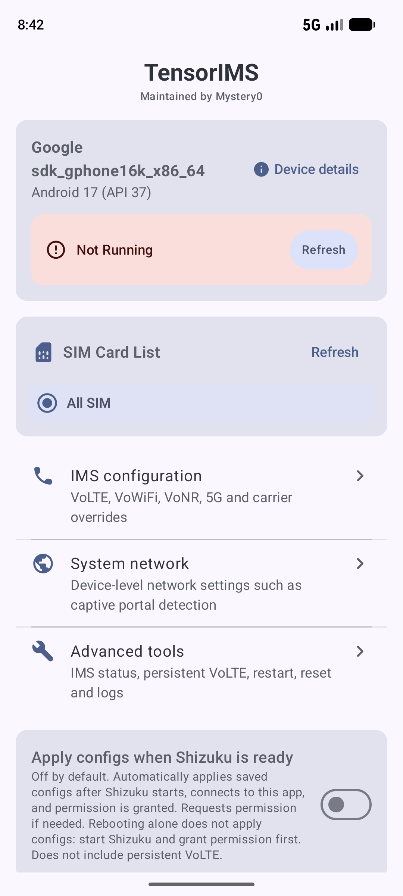
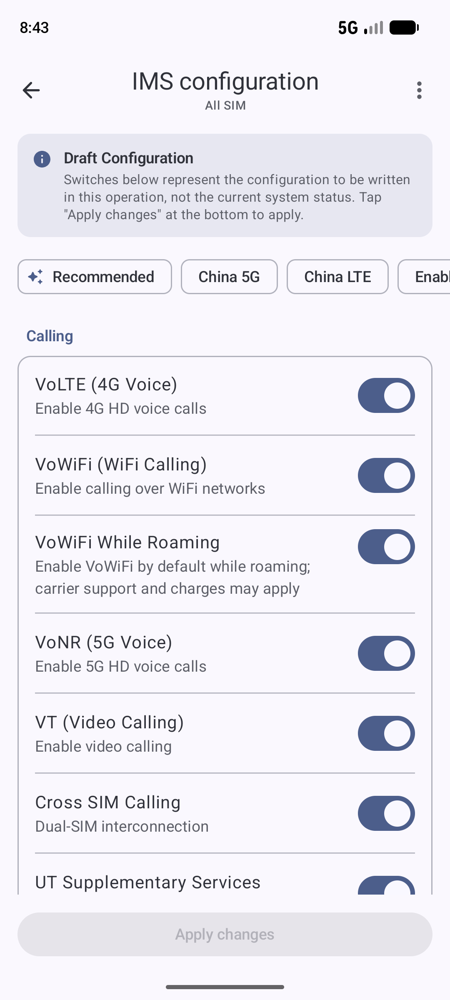
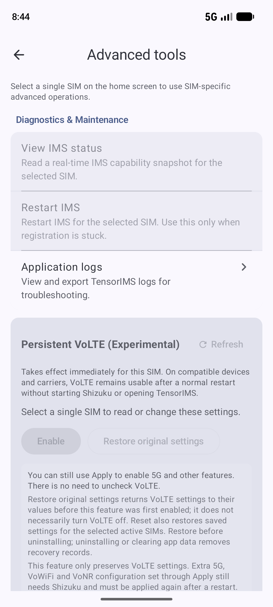

# TensorIMS

> **IMS configuration for Google Pixel devices on mainland Chinese carrier networks, independently maintained by Mystery00.**
> Previously **Mystery00/TurboIMS**, now **TensorIMS**. Requires a Google Tensor-powered Pixel device, Android 13+, and privileged access through the backend you explicitly select.
>
> Development and maintenance primarily focus on China Mobile, China Unicom, and China Telecom. Other carriers are outside the primary maintenance scope because suitable devices, SIMs, and network testing are unavailable. This does not mean other networks cannot work; compatibility must be verified on the target device.

[Download latest](https://github.com/Pixel-Tailor-CN/TensorIMS/releases/latest) · [Project website](https://pixel.mystery0.app) · [Chinese guide](README_CN.md) · [Report an issue](https://github.com/Pixel-Tailor-CN/TensorIMS/issues)

  

  <strong>Enable VoLTE, VoWiFi, and other IMS features on Google Pixel devices.</strong>

    
    
    

[简体中文](README_CN.md)

## Screenshots

  
  
  

## About

TensorIMS is a tool that allows you to enable or disable IMS features like Voice over LTE (VoLTE), Wi-Fi Calling (VoWiFi), Video Calling (VT), and 5G Voice (VoNR) on Google Pixel phones. External mode uses [Shizuku](https://shizuku.rikka.app/) or a fork with a compatible API; embedded mode requires independent wireless ADB pairing or existing root approval.

## Features

- **Structured Information Architecture**:
    - **Home Screen**: Overview of device and selected backend status, SIM selector, navigation to core modules, and the toggle for "Apply configs when the backend is ready".
    - **IMS Configuration**: Draft mode configuration organized into "Calling", "Network", "Display", and "Advanced Overrides", with one-tap quick presets and manual fine-tuning.
    - **System Network**: Dedicated device-level system network settings, offering Captive Portal probe endpoint configuration with popular presets.
    - **Advanced Tools**: Segregated into "Diagnostics & Maintenance" (IMS status snapshot, restart IMS, application logs) and "Danger Zone" (reset CarrierConfig overrides), alongside Persistent VoLTE management.
- **One-Tap Quick Presets**:
    - **Recommended**: Enables essential 4G/5G calling and network capabilities (VoLTE, VoNR, 5G NR, 5G signal threshold alignment, VT) while keeping VoWiFi disabled.
    - **China 5G**: Full 5G experience for Chinese mainland carriers with VoNR, 5GA/5G+ icon, and 5G signal threshold alignment.
    - **China LTE**: Pure 4G mode with 5G NR & VoNR explicitly disabled for stable cellular connectivity, battery saving, and thermal reduction.
    - **Enable all**: Enables all available toggleable features at once.
- **Automation & Persistence**:
    - **Start the embedded service when opening the app**: An optional, default-off setting reuses existing wireless ADB pairing credentials for one connection attempt when the app enters the foreground. Wireless debugging and the required permissions must already be available; failures can be handled with the existing manual controls. This does not start the app in the background after a reboot.
    - **Apply configs when the backend is ready**: Automatically restores saved configurations when the device reboots and the selected backend is ready and authorized.
    - **Persistent VoLTE (Experimental)**: Leverages system-level VoIMS opt-in to keep VoLTE active across device reboots without needing Shizuku on every restart.
    - **Configuration Persistence**: Automatically saves configuration history per SIM card or for all SIMs.
- **Customizable IMS Features**:
    - **Carrier Name**: Override the carrier name displayed on your device.
    - **IMS User Agent**: Override the IMS User Agent string.
    - **VoLTE (Voice over LTE)**: Enable high-definition voice calls over 4G.
    - **VoWiFi (Wi-Fi Calling)**: Make calls over Wi-Fi networks, with options for Wi-Fi only mode.
    - **VT (Video Calling)**: Enable IMS-based video calls.
    - **VoNR (Voice over 5G)**: Enable high-definition voice calls over 5G (Requires Android 14+).
    - **Cross-SIM Calling**: Enable dual-SIM interconnection features.
    - **UT (Supplementary Services)**: Enable call forwarding, call waiting, and other supplementary services over UT.
    - **5G NR**: Enable 5G NSA (Non-Standalone) and SA (Standalone) networks.
    - **5G Signal Strength Thresholds**: Option to apply custom 5G signal strength thresholds.
    - **5G+/5GA Icon**: Configure the carrier thresholds used by Android to expose the enhanced 5G icon.
    - **Enhanced 4G LTE (LTE+)**: Enable the system carrier configuration used for LTE+/4G+ support.
    - **Hide Enhanced Data Icon**: Optionally hide the LTE+/4G+ data icon; actual LTE+/4G+ availability still depends on the device, carrier, and current network.
    - **Show 4G for LTE**: Display the 4G label for LTE data.
- **System Network / Captive Portal**: Read, override, or remove SettingsProvider values for Android's `captive_portal_http_url` and `captive_portal_https_url`, with built-in presets (Google, V2EX, Xiaomi, vivo, Huawei).
- **Logcat Viewer**: View and export application logs for troubleshooting.

> **Captive Portal limitation:** TensorIMS verifies the values written to SettingsProvider, but some Android/NetworkStack builds may prefer resource overlays over those values. A successful write therefore does **not** prove that the active network probe URL changed. Reconnect the network and verify behavior on the target device.

## Requirements

- **Supported Devices**: Google Pixel devices with Google Tensor chips.
    - Pixel 6, 6 Pro, 6a
    - Pixel 7, 7 Pro, 7a
    - Pixel 8, 8 Pro, 8a
    - Pixel 9, 9 Pro, 9 Pro XL, 9 Pro Fold, 9a
    - Pixel 10, 10 Pro, 10 Pro XL, 10 Pro Fold, 10a
    - Pixel 11, 11 Pro, 11 Pro XL, 11 Pro Fold
    - Pixel Fold, Pixel Tablet
    - **Note:** Devices with Qualcomm Snapdragons (Pixel 5 and older) are NOT supported.
- Android 13 or higher
- External mode: [Shizuku](https://shizuku.rikka.app/) installed, running and authorized; embedded mode: explicit wireless ADB pairing or existing root approval

## Installation

1. Choose the APK by application ID on the [Releases](https://github.com/Pixel-Tailor-CN/TensorIMS/releases) page: `app.mystery0.ims.tensor` for a separate installation, or `io.github.vvb2060.ims` to keep the old application identity. Both include external and embedded modes.
2. Check the APK signature and version before installation, and preserve existing app data. Do not uninstall the old app to bypass a signature mismatch.
3. Open **Privilege mode** from the device card on the home screen. External mode requires Shizuku to be running and authorized; embedded mode can be started manually through wireless debugging pairing, computer ADB, or existing root access. Once the backend is ready, read the current configuration before making changes.

The new and legacy packages store data separately and do not migrate it automatically. Updating the legacy package requires a matching signature and a higher version code. Before switching packages, disable auto-restore, restore the legacy app's original Persistent VoLTE values, and retain its data. Do not let both packages automatically modify the same SIM at the same time.

Compatibility depends on the device and system version. The device list and historical screenshots do not imply that every feature has passed real-device validation.

## Usage

1. **Check Status**: Ensure the selected backend is running and authorized.
2. **Select SIM**: Choose the single SIM card or "All SIM" to configure on the home screen.
3. **IMS Configuration**: Open **IMS configuration**, pick a quick preset ("Recommended", "China 5G", or "China LTE") or adjust switches by category, then tap **Apply changes**.
4. **Auto-Restore (Optional)**: Enable "Apply configs when the backend is ready" on the home screen to automatically restore configurations after reboots once the selected backend is ready.
5. **System Network**: Open **System network** to manage Captive Portal detection URLs with one-tap presets; changes apply globally across the device.
6. **Advanced Tools**: Use the advanced page to inspect real-time IMS capability snapshots, restart IMS if needed, or reset CarrierConfig overrides in the Danger Zone.

> Follow the reset status shown in the app. A status indicating that the reset was requested but remains unconfirmed does not mean restoration has been confirmed successful.
> If the reset request and permission cleanup completed but override removal cannot be independently verified, the backend remains usable. Automatic application is paused, and the affected SIM's previous history is excluded from automatic restoration. Reload the configuration to inspect the result.

## About this Project

This project originated as a fork of [Turbo1123/TurboIMS](https://github.com/Turbo1123/TurboIMS). However, due to various stability issues encountered during usage, the codebase has undergone a complete refactoring. This includes rewriting the core logic for SIM card reading and carrier configuration, as well as redesigning the UI and icons.

This project was previously released as **Mystery00/TurboIMS** and continues to be maintained independently as **TensorIMS**, with no plans to merge future upstream changes. The rename applies only to this maintained version; the original fork relationship and attribution remain on GitHub.

## Credits

- **[vvb2060/Ims](https://github.com/vvb2060/Ims)**
- **[nullbytepl/CarrierVanityName](https://github.com/nullbytepl/CarrierVanityName)**: Carrier name modification logic is derived from this project.
- **[kyujin-cho/pixel-volte-patch](https://github.com/kyujin-cho/pixel-volte-patch)**
- The app icon is based on an original design from [iconfont](https://www.iconfont.cn/collections/detail?cid=28924), modified for use in this project.

## Disclaimer

This application modifies your device's carrier configuration and, when requested, selected device-level network settings. Use it at your own risk. The developers are not responsible for any damage or loss of functionality.

## License

This project is licensed under the Apache License 2.0. See the [LICENSE](LICENSE) file for details.

### App Language

Tap the gear icon at the top right of the home screen to open **App settings**. Choose to follow the system language, use English, or use Simplified Chinese. The default follows the system. Changes take effect immediately, are saved by Android, and stay synchronized with the system's per-app language settings.
