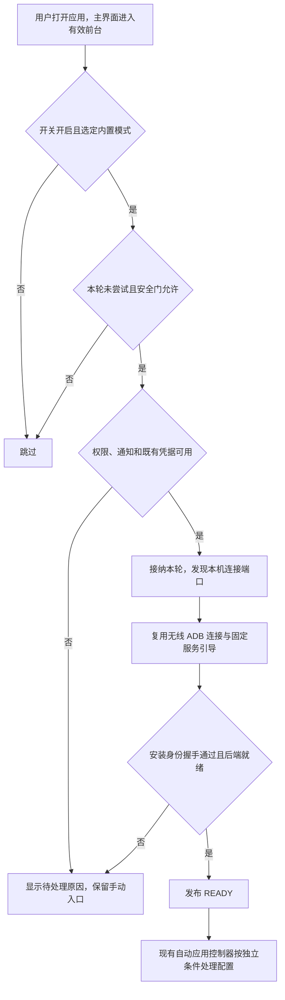

# 打开应用时自动启动内置服务设计

- 日期：2026-10-13
- 状态：用户已确认设计，代码已实施；独立审查、双包编译、完整单测与 lint 已通过，真机无线启动尚待验收
- 基线：`642e5c3`，外置 Shizuku 文案统一修改之后
- 范围：在用户主动打开应用时，按独立开关自动尝试已有无线 ADB 连接与内置服务启动

## 1. 用户目标与功能边界

用户已经为当前安装包完成无线调试配对，能够通过“连接并启动服务”启动内置 Shizuku，希望重新打开应用或设备重启后首次打开应用时，自动执行这一步。

功能名称采用“打开应用时自动启动内置服务”，默认关闭。它自动执行现有的连接与启动流程；服务通过身份验证并进入 `READY` 后，现有“所选后端就绪后自动应用配置”根据自己的开关、历史及安全条件决定是否应用配置。

只有以下前提均满足时，用户才可以直接打开应用并等待就绪，无需再次配对或点击启动按钮：

- 当前选择内置模式，且主动启用了本功能。
- 当前安装包的 ADB 凭据可读取，系统仍认可该配对身份。
- 本机无线调试连接服务可发现、可连接。
- 必要权限已经授予，应用通知和无线启动通知渠道可用。
- 没有在途操作、恢复核对或其他启动流程阻止启动。

首版不增加开机广播启动、进程保活、后台周期重试、闹钟或独立常驻前台服务。不自动打开系统无线调试，不自动重新配对，不生成或替换 ADB 身份，不申请 root，不创建电脑 ADB 启动等待，不控制外置 Shizuku。

设备重启只结束旧服务；自动启动仍须等用户解锁并将应用打开到前台。普通后台初始化、Provider 调用或 Instrumentation 创建应用进程都不构成自动启动授权。

## 2. 当前实现与复用依据

| 现有组件 | 当前职责 | 本功能的使用方式 |
| --- | --- | --- |
| `AppSettingsRepository` | 按安装包保存 `app_settings`，管理主题、自动日志和闲置停止 | 保存独立开关，不写入 SIM 历史或 `auto_restore` |
| `Application` | 用户解锁后初始化后端、自动应用和闲置停止 | 注册应用级控制器，但不在初始化时发起启动 |
| `MainActivity` / `MainViewModel` | 承载界面、处理用户动作和当前启动状态 | 提供有效前台事件与开关操作，不直接执行 ADB |
| `WirelessAdbService.startConnect` | 启动短时前台流程，发现连接端口，再启动服务 | 复用 CONNECT 路径及通知，区分手动和自动来源 |
| `AdbIdentity.load(pairing = false)` | 读取既有加密凭据；缺失或失效时拒绝连接 | 作为凭据预检查和实际连接入口，不改用配对路径 |
| `PrivilegeRuntime.startEmbedded` / `OperationCoordinator` | 串行协调启动、模式切换与特权业务 | 自动启动使用相同安全门，拒绝排队执行迟到启动 |
| `EmbeddedLauncher.startWireless` / `EmbeddedConnection` | 固定引导命令、一次性挑战及安装身份握手 | 保留既有本机地址、挑战、UID、签名、版本和 epoch 校验 |
| `AutoRestoreController` | 监听 `READY` 并按历史尝试自动应用 | 不增加新的配置应用入口或恢复授权 |
| `EmbeddedIdleStopController` | 应用在后台且任务结束后，按用户偏好等待闲置停止 | 自动启动纳入已有无线任务忙碌状态，停止后不在后台拉起 |

现有 `WirelessAdbState.pairedInSession` 仅表示当前通知会话完成配对，不持久化。ADB 身份也可能在一次失败的配对尝试中已经生成，因此不能把这个字段或密钥文件存在当作“系统当前已授权”。首版不另造权威配对标记：可读取的既有身份只允许一次连接尝试，系统是否仍接受它，以实际连接认证为准。

模式仍使用 `BackendMode.EMBEDDED`；外置模式仍保留内部名称 `BackendMode.OFFICIAL` 和既有偏好值。两 flavor 共用业务代码，各自使用自己的 applicationId、身份、凭据和设置。

## 3. 界面与偏好

### 3.1 放置位置

在“特权模式”页增加独立卡片，仅当选定内置模式时显示。服务未就绪时也显示，以便用户管理启动偏好；隐藏卡片不清除开关。

建议文案：

- 标题：**打开应用时自动启动内置服务**
- 说明：**默认关闭。打开应用时，尝试使用已有无线调试配对连接并启动内置服务。需要无线调试可用及所需权限，不会自动重新配对或使用 root。**
- 补充：**启动成功后，是否应用已保存配置由首页的自动应用开关决定。**

UI 不显示凭据文件路径、挑战、内部状态名称等实现细节，不承诺任意系统或网络条件下均无需用户操作。

### 3.2 保存与启用

- 在各安装包独立的 `app_settings` 中保存 `embedded_auto_start`，默认 `false`。
- 切换到外置模式保留偏好，但立即停止产生自动启动请求。
- 用户主动开启时，可一次性申请已有无线启动流程需要的通知权限及 Android 17+ 本地网络权限；拒绝不循环弹窗。
- 权限拒绝、通知渠道关闭或凭据缺失时，保留用户选择并显示“当前无法自动启动”的原因与手动处理入口。
- 自动检查本身不弹权限窗口、配对界面或系统设置；再次授权必须来自明确点击。
- 开启开关且条件已齐备时，可在当前前台尝试一次。用户关闭再开启属于新的显式选择，可重新检查；不得与未结束的旧任务并发。
- 关闭开关不停止已经就绪的内置服务，也不关闭自动应用配置。停止服务仍遵循原有受控入口和闲置停止偏好。

所有用户文案同步提供中文、英文资源；代码注释中文，日志消息英文。

## 4. 前台触发与去重

### 4.1 什么算一次打开应用

应用级控制器维护“前台代际”，并结合 `MainActivity` 的有效恢复事件发起检查：

1. 用户解锁后，应用首次进入前台，主界面可交互时检查一次。
2. 整个应用确实进入后台，之后用户再次返回主界面时，进入新代际，可再检查一次。
3. Compose 页面切换、Activity 配置重建、旋转、主界面与日志页之间切换，不创建新代际。
4. 应用处于多窗口可见状态时，须至少有已恢复的 `MainActivity`；只有后台进程或日志页初始化不能发起启动。

复用应用级 Activity 生命周期观察思路，使用短暂后台去抖，例如 700 毫秒，并处理 `isChangingConfigurations`，避免两个 Activity 交接或配置重建时被误认为离开应用。该延迟只用于生命周期去重，不承担保活或定时启动。

用户从开发者选项等外部页面主动返回主界面，可以进入新的有效前台代际并再次检查。应用不会自行打开设置，所以不会通过页面跳转制造自动重试循环。

### 4.2 一轮的消费规则

- 每个前台代际最多接纳一轮由打开应用触发的自动连接任务；失败、超时或用户取消后不在同一代际再次自动发起。
- 当前服务已就绪时，本轮检查以“无需启动”结束。之后同一前台代际内即使服务断开，也不通过状态变化追加启动。
- 用户在前台明确关闭再开启开关，可创建新的显式启用代际并授权一次检查；它不是失败后的自动重试，仍须等待旧任务安全结束。请求以“前台代际 + 显式启用代际”识别和去重。
- 任务接纳前记录已消费请求，跳过就绪或安全门阻塞时也结束本次检查，避免状态流重复发射、重组或迟到回调重复启动。
- 开关关闭和外置模式只做跳过；模式切换本身不触发自动启动。切回内置模式后，须下一次有效前台进入或用户明确重新启用开关才再次检查。
- 手动配对、无线启动、root 启动或电脑等待获得启动所有权后，当前代际由手动流程处理，不在结束或取消后追加自动启动。
- 前台首次状态检查尚未完成时，可以等待该检查的结果；不能因普通业务忙碌而排队等待启动。
- 进入 `BUSY`、`CONNECTING`、`SWITCHING` 或 `RECOVERY_REQUIRED` 后，跳过本代际自动启动；即使随后解除阻塞，也不通过后台观察继续发起。用户可以手动启动或在下一个有效前台代际重试。
- 已接纳任务尚未结束时，新的前台事件不能创建第二个任务。

关闭开关、切换模式、进程结束均使尚未接纳的请求失效。前台代际和显式启用代际只保存在内存中，不通过磁盘保存待执行启动请求，也不在进程重建后重放旧请求。

## 5. 启动门禁与调用链

新增小型 `EmbeddedAutoStartController` 管理生命周期、去重和原因展示，配合纯逻辑 `EmbeddedAutoStartPolicy`。控制器不执行 shell 命令，不接管配置应用或服务停止。

在准备检查时以及启动接纳瞬间，至少验证：

1. 用户已解锁，主界面仍处于本轮有效前台。
2. 本包开关仍开启，当前模式仍为 `EMBEDDED`，epoch 与请求一致。
3. 后端为普通未连接状态；已就绪无需启动，身份验证失败等 `BLOCKED` 状态交给手动处理。
4. 没有在途操作、未知结果、未完成操作记录或恢复核对；不得使用恢复期间专门开放的重连入口自动启动。
5. 没有手动/自动无线会话、root 启动或电脑等待占用启动流程，也没有其他统一协调器业务占用安全门。
6. 权限、通知和现有凭据满足连接尝试要求。

既有 `restore_paused` 不等同于连接禁止：若后端只是普通未连接且没有恢复态或未完成任务，可以启动服务供用户核对配置；自动应用仍受原有暂停标记约束。



凭据预检查放在后台调度器中，避免主线程进行 Keystore 解密。检查完成后重新核对前台、开关、模式、epoch 与任务所有权，不能使用预检查前的旧快照派发启动。

自动入口调用 CONNECT，不调用 PAIR，也不绕过 `PrivilegeRuntime.startEmbedded`。手动与自动任务的所有权须在短时服务接纳和运行时安全门处再次检查；不能只靠 Compose 按钮禁用或控制器的布尔值。

在现有会话状态中增加有限的启动来源与本轮归属信息，用于显示、去重和取消，不提供任意命令、目标地址或 Binder 转发。自动启动最终仍须经过一次性挑战、当前安装身份和存活 Binder 握手。

## 6. 无线连接、超时与取消

### 6.1 已配对不等于随时可连接

每轮重新发现 `_adb-tls-connect._tcp` 端口，只接受本机地址，不缓存端口或使用配对端口。现有 `AdbServiceDiscovery` 的本机地址筛选和 `LoopbackConnection` 限制继续保留。

不把 `Settings.Global.adb_wifi_enabled` 单独当作跨版本可连接性的证明。未发现连接服务时显示“未发现本机无线调试连接服务，请确认无线调试可用”，不直接宣称用户已关闭无线调试或配对已失效。

身份缺失、密文不可解密或系统拒绝认证时，保留当前身份和其他数据，提供手动配对入口。禁止在自动连接路径调用 `AdbIdentity.load(pairing = true)` 补身份，禁止读取或记录配对码。

### 6.2 有界执行

复用现有无线短时前台服务、进度通知和取消动作：

- 连接端口发现单次最多 20 秒。
- 沿用现有网络、引导、握手的各阶段边界，以及整轮最多 150 秒的限制。
- 发现结束或取消后释放 NSD、组播锁、Socket 和一次性启动等待。
- 不因超时重新配对、刷新挑战延长等待、自动使用 root，或创建电脑等待。
- 无需用户点击启动不等于无通知；进行中的连接仍显示已有短时通知。

### 6.3 离开前台与关闭开关

待检查、凭据预检查或端口发现阶段离开前台时，撤销本轮自动请求；下一次打开应用可以重新检查。

任务已进入固定引导和握手阶段后，沿用既有有界清理与取消保护，不因 UI 离开而提前释放协调器或接受迟到 Binder。关闭开关只撤销属于本轮自动任务的启动许可和等待，不使用无来源区分的全局取消去中断手动任务，不强停已就绪服务。

取消、超时和握手竞争以会话归属及 epoch 裁定：迟到回调不得覆盖新一轮状态，旧挑战不得重新交付。已经被运行时确认为成功的服务交由现有生命周期和闲置停止管理。

## 7. 用户状态与失败处理

自动启动的偏好、尝试进度与后端连接状态分别表达。开关开启只代表允许尝试，不代表已经启动成功。

| 情况 | 行为与提示 |
| --- | --- |
| 服务已就绪 | 不再启动，继续显示就绪 |
| 正在自动连接 | 复用现有连接进度与取消入口，注明由自动启动发起 |
| 无现有可用凭据 | 不创建身份；提示先手动完成无线调试配对 |
| 必要权限或通知渠道不可用 | 不弹自动授权窗口；显示原因和明确点击的处理入口 |
| 未发现本机连接服务 | 结束本轮，提示检查无线调试与网络；允许手动重试 |
| TLS 认证被拒绝 | 结束本轮，提示现有授权可能失效；不自动重配对 |
| 后端身份或版本验证失败 | 保持未就绪，不调用其他启动方式掩盖失败 |
| 操作忙碌或恢复核对 | 跳过本轮，优先显示现有真实后端状态和核对步骤 |
| 用户取消或关闭开关 | 取消本轮尚未完成的自动许可，不在同轮再次启动 |
| 启动超时或失败 | 保留手动按钮与错误原因，不重放未知引导或特权业务 |

本轮原因同时可在特权模式页查看；首页继续由后端状态卡显示未连接、连接中、就绪或恢复核对，不把自动启动失败伪装成 SIM 缺失。

不在每次打开应用时重复弹失败对话框。进度和失败复用已有无线通知及页面状态，不新增通知渠道。日志只记录英文阶段、跳过原因与异常类别，不包含身份私钥、配对码、挑战或完整启动命令。

## 8. 与其他功能的协作

### 8.1 自动应用配置

两个开关独立。自动启动不读写配置历史、自动应用开关或恢复确认标记，也不直接调用 IMS 写入。

- 仅自动启动开启：服务就绪，等待用户操作。
- 仅自动应用开启：继续等待用户手动启动所选后端。
- 两者均开启：本轮启动通过并进入 `READY` 后，由现有控制器应用可恢复历史。
- 自动应用处于安全暂停：服务即使就绪，也不解除暂停；仍由用户核对后关闭再开启自动应用开关。

同次开机去重、SIM 身份校验、重置阻止标记、逐卡回读和结果汇总全部沿用现有协议。持久化 VoLTE 和 Captive Portal 不因新增开关参与自动应用。

### 8.2 闲置停止

自动连接继续体现在现有无线会话忙碌状态中；闲置停止不能与连接、启动、自动应用或未完成清理并发。

后台闲置停止后，保持内置模式和自启动偏好，但不在后台重新启动。用户之后重新打开应用，产生新前台代际时，才可自动尝试。服务在同一个前台代际意外断开，也不持续自动拉起。

### 8.3 两个安装包

`tensor` 和 `legacy` 的开关、凭据、通知、会话、Provider 与服务身份各自独立。自动入口不得读取另一包的凭据、跨包配对、停止另一包服务或切换后端。两包同时启用自动应用修改同一 SIM 的限制仍适用。

## 9. 实施边界与兼容维护

预计修改集中于应用设置存储、应用级控制器、前台事件连接、无线启动来源/门禁、特权模式页和中英文资源。Activity 只提供生命周期事件，UI 不直接执行 ADB 或业务写入，不引入新的依赖注入、持久化或后台调度框架。

不修改隐藏 API 签名、原生电脑启动器领取协议或通用特权操作范围。Android 13+ 通知要求、Android 17+ 本地网络门禁，以及 Android 14+ `shortService` 适配沿用现有实现。

实施时需同步更新 `AGENTS.md` 中“无线启动须由用户操作”的约定：允许用户明确开启本开关之后、有效前台进入时的有限自动连接。自动应用控制器本身仍不得启动服务；禁止后台自动配对、提权和反复请求权限的约束保持有效。双语 README 补充开关的条件、失败后的手动处理和开机后仍需打开应用的行为。

代码实施与维护约束、双语用户文档同步更新；实施步骤和验证边界见[实施计划](2026-10-13-embedded-auto-start-plan.md)。

## 10. 验收标准

| 场景 | 预期结果 |
| --- | --- |
| 默认设置、UNSET 或外置模式 | 不自动启动、不弹权限或配对窗口 |
| 已配对、条件满足，冷启动应用 | 自动 CONNECT，一次握手，最终就绪，无需重新配对 |
| 设备重启但未打开应用 | 不主动创建启动任务 |
| 重启后解锁并首次打开应用 | 条件满足时自动启动；条件缺失时准确提示 |
| 旋转、配置重建、Compose 导航、日志页切换 | 不创建第二轮启动或重复通知会话 |
| 回到后台后再次打开，服务已就绪 | 不重复启动 |
| 闲置停止后再打开应用 | 在新代际尝试一次，不在后台拉起 |
| 凭据文件来自失败配对、系统已忘记身份或密文失效 | 不伪称已配对，不换身份；结束并提供手动处理 |
| 无线调试不可发现或端口已变化 | 有界退出或使用新发现的连接端口，不复用旧端口 |
| 通知被拒绝、渠道关闭、本地网络权限缺失 | 自动路径不请求权限，手动处理入口可用 |
| 手动启动与自动检查竞争 | 只接纳一个会话；取消自动任务不伤及手动任务 |
| 业务忙碌、模式切换、恢复核对、未完成日志 | 自动启动被拒绝，不绕过已有安全门 |
| 开关关闭、模式/epoch 变化、取消与迟到握手竞争 | 旧许可失效，状态不会被旧回调覆盖 |
| 后台 Provider 或 Instrumentation 初始化进程 | 不视为用户打开应用，不触发自启动 |
| 自动启动与自动应用同时开启 | 仅在真实 `READY` 后沿用现有历史应用协议 |
| `restore_paused` 仍为 true | 不自动解除暂停或重放上次未知写入 |
| 两个 flavor 分别验收 | 使用各包独立偏好、凭据、通知和服务身份 |

代码实施至少执行双 flavor Debug 编译：

```powershell
.\gradlew.bat :app:assembleTensorDebug :app:assembleLegacyDebug --stacktrace --console=plain
```

针对去重、取消、状态门禁和任务所有权增加有意义的纯 Kotlin 行为测试；按项目约定执行相应单测和 lint。真实 Pixel 设备验证覆盖 Android 13 至 Android 17 的相关权限与服务差异，优先当前已连接设备，再补充不同版本设备；不可用矩阵明确记录，不能用编译或模拟器替代真实启动验收。不得为验证而清除已有配对、应用数据或 VoLTE 备份，也不得用签名不同的 debug 包覆盖正式版。

## 11. 参考依据

- [Android 无线 ADB 文档](https://developer.android.com/tools/adb#connect-to-a-device-over-wi-fi)：配对与连接分离，配对保留与授权撤销，以及无线调试可用性的前提。
- [Android 前台服务启动限制](https://developer.android.com/develop/background-work/services/fgs/restrictions-bg-start)：前台可见触发与后台启动边界。
- [内置服务双模式设计](2026-10-01-tensorims-dual-mode-design.md)：后端选择、身份验证、协调器和恢复约束。
- [双包发布设计](2026-10-02-dual-package-release-design.md)：安装身份与数据隔离。
- [原生电脑 ADB 启动器设计](2026-10-11-native-adb-starter-design.md)：电脑等待与一次性领取边界，不纳入自动启动。

平台资料于 2026-10-13 核对；具体设备上的凭据授权和发现结果仍以实际连接验证为准。
